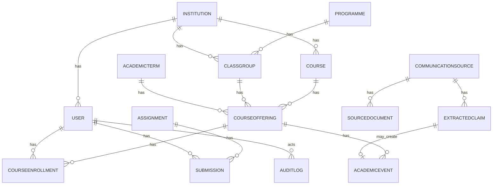

# Data Model — Okoa Sem

Status: Proposed
Related: [System Design](./SYSTEM_DESIGN.md), [API Design](./API_DESIGN.md), [Academic Lifecycle](./ACADEMIC_INFORMATION_LIFECYCLE.md)

## 1. Conventions

- Primary keys: UUID.
- Timestamps: `created_at`, `updated_at` (timestamptz), `deleted_at` where soft delete.
- Tenant scope: `institution_id` on tenant-scoped tables.
- Enums stored as text with check constraints or native enums (decide in migration).
- Money not applicable.

## 2. MVP vs future

MVP entities: User, Institution, Department (optional minimal), Programme, AcademicTerm, ClassGroup, Course, CourseOffering, CourseEnrollment, CommunicationSource, SourceDocument, ExtractedClaim, AcademicEvent, Assignment, Submission (basic), Reminder, Notification, AuditLog.
Future: CourseMaterial (basic MVP maybe), AgentRun, detailed Submission grading, Acknowledgement, IntegrationAccount.

## 3. Entities

### User
- id (PK), email (unique), full_name, role (enum), institution_id (FK), auth_provider_id, created_at, updated_at, deleted_at.
- Relationships: belongs to Institution; has many CourseEnrollment, Submission, Notification.

### Institution
- id, name, code (unique), country (default Kenya), timezone, created_at.
- Relationships: has many Department, Programme, User, ClassGroup, Course.

### Department
- id, institution_id, name, code.
- MVP: optional; can be deferred but included for future.

### Programme
- id, institution_id, department_id, name, code, duration_years.

### AcademicTerm
- id, institution_id, name, start_date, end_date, is_current.

### ClassGroup
- id, institution_id, programme_id, year_of_study, group_code, academic_term_id.
- Represents a cohort/class.

### Course
- id, institution_id, code, name, credit_hours, department_id.

### CourseOffering
- id, course_id, academic_term_id, class_group_id, lecturer_id (User), venue_default, schedule_notes.
- Unique: course + term + class group.

### CourseEnrollment
- id, user_id (student), course_offering_id, status (active/dropped), enrolled_at.
- Unique: user + offering.

### CommunicationSource
- id, institution_id, type (paste, whatsapp_export, email, pdf, image, manual), submitted_by (User), submitted_at, metadata (jsonb), processing_status.

### SourceDocument
- id, communication_source_id, file_path, mime_type, size_bytes, checksum, extracted_text, ocr_status.

### ExtractedClaim
- id, communication_source_id, source_document_id (nullable), claim_type (enum), title, description, course_offering_id (nullable), academic_event_id (nullable), proposed_payload (jsonb), confidence (0-1), status (pending, approved, rejected, merged, failed), extracted_at, verified_by, verified_at, rejection_reason, model_name, prompt_version.

### AcademicEvent
- id, institution_id, course_offering_id (nullable), event_type (cat, exam, assignment, lecture, meeting, deadline, venue_change, announcement), title, description, start_at, end_at, venue, status (draft, verified, superseded, cancelled), source_claim_id (FK ExtractedClaim nullable), created_by, verified_by, version, created_at, updated_at.
- Represents a confirmed academic event.

### Assignment
- id, academic_event_id (nullable), course_offering_id, title, instructions, due_at, submission_type, max_score, created_by, status.

### Submission
- id, assignment_id, student_id, submitted_at, status (not_submitted, submitted, late, graded), file_path, grade, feedback, graded_by, graded_at.

### CourseMaterial
- id, course_offering_id, title, file_path, uploaded_by, uploaded_at.

### Reminder
- id, user_id, academic_event_id (nullable), assignment_id (nullable), remind_at, channel, status (scheduled, sent, cancelled, failed), created_at.

### Notification
- id, user_id, type, title, body, related_entity_type, related_entity_id, read_at, created_at.

### AgentRun
- id, user_id, agent_name, input_summary, tools_used (jsonb), output_summary, status, started_at, ended_at, token_usage, cost_estimate.

### AuditLog
- id, actor_id, action, entity_type, entity_id, before (jsonb), after (jsonb), created_at, ip, user_agent.

## 4. Key relationships

## 5. Constraints and indexes

- Unique emails per institution? Global unique email simplest; note if same person across institutions future.
- `CourseOffering` unique (course_id, academic_term_id, class_group_id).
- `CourseEnrollment` unique (user_id, course_offering_id).
- Indexes: `(institution_id)`, `(course_offering_id, start_at)` on AcademicEvent, `(user_id, read_at)` on Notification, `(status, remind_at)` on Reminder.
- Foreign keys with ON DELETE RESTRICT for academic records; CASCADE only for join/child records where appropriate.

## 6. Ownership and retention

- Institution owns institutional data; students own personal profile.
- Retention: audit logs 7 years (proposed); source documents per institution policy; deletions on request per privacy policy.
- Soft delete for users/courses; hard purge for PII on verified request.

## 7. Change history

- `AcademicEvent.version` increments on update; prior versions stored in `AuditLog` (before/after) or a dedicated `AcademicEventVersion` table (future). MVP uses AuditLog.
- `ExtractedClaim` never overwritten; new claims reference prior via metadata.
