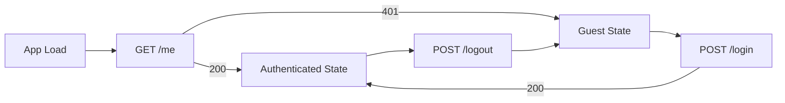

# Frontend Integration Guide — Okoa Sem

Status: IMPLEMENTED backend contract for authentication; Cloudinary upload workflow NOT YET IMPLEMENTED.

## A. Authentication API contract

Base URL (development): `http://localhost:5000`
API prefix: `/api/v1`

| Method | Endpoint | Purpose |
|---|---|---|
| POST | `/api/v1/auth/register` | Register a student |
| POST | `/api/v1/auth/login` | Authenticate |
| GET | `/api/v1/auth/me` | Retrieve current user |
| POST | `/api/v1/auth/logout` | End current session |

Health endpoints:
- `GET /api/v1/health`
- `GET /api/v1/health/database`

### Registration

`POST /api/v1/auth/register`

Headers:
- `Content-Type: application/json`

Request body:
```json
{
  "fullName": "Test Student",
  "email": "student@example.com",
  "password": "StrongPass1"
}
```

Password policy: at least 8 characters, maximum 128, with lowercase, uppercase and number.

Successful response: `201 Created`
```json
{
  "data": {
    "id": "uuid",
    "email": "student@example.com",
    "fullName": "Test Student",
    "accountStatus": "active",
    "emailVerified": false,
    "memberships": [
      {
        "id": "uuid",
        "workspaceId": "uuid",
        "workspaceName": "Okoa Sem Default Workspace",
        "workspaceCode": "OKOA-DEFAULT",
        "role": "student",
        "status": "active"
      }
    ]
  }
}
```

Errors:
- `400` invalid JSON.
- `422` validation error.
- `409` duplicate email (`EMAIL_ALREADY_EXISTS`).
- `500` server error.

### Login

`POST /api/v1/auth/login`

Headers:
- `Content-Type: application/json`

Request body:
```json
{
  "email": "student@example.com",
  "password": "StrongPass1"
}
```

Successful response: `200 OK`
```json
{
  "data": {
    "id": "uuid",
    "email": "student@example.com",
    "fullName": "Test Student",
    "accountStatus": "active",
    "emailVerified": false,
    "memberships": []
  }
}
```

Sets cookie: `okoa_session` (HttpOnly).

Errors:
- `401` invalid credentials (`INVALID_CREDENTIALS`).
- `422` validation error.
- `429` rate limited (`RATE_LIMITED`).

### Current user

`GET /api/v1/auth/me`

Requires valid session cookie.

Successful response: `200 OK`
```json
{
  "data": {
    "id": "uuid",
    "email": "student@example.com",
    "fullName": "Test Student",
    "accountStatus": "active",
    "emailVerified": false,
    "memberships": []
  }
}
```

Errors:
- `401` unauthenticated (`UNAUTHENTICATED`).

### Logout

`POST /api/v1/auth/logout`

Requires valid session cookie.

Successful response: `204 No Content`

Errors:
- `401` unauthenticated.

## B. Session authentication

Okoa Sem uses server-managed opaque sessions, not frontend-managed JWTs.

Frontend requirements:
- Do not store tokens in localStorage.
- Do not store tokens in sessionStorage.
- Do not manually manage session tokens.
- Let the browser store the HttpOnly `okoa_session` cookie.
- Send requests with `credentials: "include"`.
- Restore auth state on app load using `/api/v1/auth/me`.
- Call logout to end the session.
- Clear frontend auth state when `/me` returns 401.

Cookie configuration:
- Name: `okoa_session`
- HttpOnly: true
- Secure: true in production, false in development
- SameSite: Lax
- Path: `/`
- Max age: 7 days

## C. CORS and environment configuration

Development:
- Frontend: `http://localhost:5173`
- Backend: `http://localhost:5000`
- `FRONTEND_URL=http://localhost:5173`
- `VITE_API_URL=http://localhost:5000/api/v1`

Backend CORS:
- Origin must be the frontend origin.
- Credentials must be enabled.
- Wildcard origins cannot be used with credentialed requests.

Production:
- Set `FRONTEND_URL` to the deployed frontend origin.
- Set `VITE_API_URL` to the deployed backend API base.
- Use HTTPS so Secure cookies work.

## D. Frontend authentication flow

1. Registration: submit form to register endpoint; on success route to login or dashboard.
2. Login: submit credentials; backend sets cookie; store user from response.
3. App startup: call `/me`; if 200 set user; if 401 clear user.
4. Protected routes: redirect unauthenticated users to login.
5. Logout: call logout; clear user state.
6. Expired/invalid session: treat 401 as logged out.



## E. User and role handling

Permitted roles:
- `student`
- `class_rep`
- `lecturer`

Roles belong to workspace memberships. A user may have different roles in different workspaces.

The frontend may use roles for display decisions only. The backend enforces authorization.

Public registration always creates a `student` membership. Students cannot choose privileged roles.

Consume `memberships` from the `/me` response. Do not assume a single workspace.

## F. Error handling

Error response format:
```json
{
  "error": {
    "code": "ERROR_CODE",
    "message": "Human readable message",
    "details": [{ "field": "email", "message": "Invalid email" }],
    "requestId": "uuid"
  }
}
```

Status handling:
- 400: malformed request.
- 401: unauthenticated or invalid session; clear auth state.
- 403: forbidden.
- 409: duplicate account.
- 422: validation errors; show field errors.
- 429: rate limited; show retry message.
- 500/503: server/database failure; show generic error.

## Cloudinary frontend handoff

IMPLEMENTED:
- Server-side Cloudinary configuration.
- Storage service/provider.
- Upload validation and signed URL helper.

NOT YET IMPLEMENTED:
- Academic document ingestion workflow.
- Frontend upload screens.
- Document ownership/authorization workflow.
- AI document extraction.

Rules:
- Frontend must never receive Cloudinary API secrets.
- Frontend must not upload private academic documents using exposed credentials.
- Backend must authorize file ownership and access.
- Private files must not use permanent public URLs.

No public upload endpoint exists yet. Document the future contract only.

## Postman

Import:
- `docs/postman/Okoa-Sem-API.postman_collection.json`
- `docs/postman/Okoa-Sem-Local.postman_environment.json`

Set `baseUrl` to `http://localhost:5000` and `apiPrefix` to `/api/v1`. Enable cookies in Postman. Run Register → Login → Current User → Logout.

## Links

- [API Design](./API_DESIGN.md)
- [Security](./SECURITY.md)
- [Deployment](./DEPLOYMENT.md)
- [Integration Contracts](./INTEGRATION_CONTRACTS.md)
