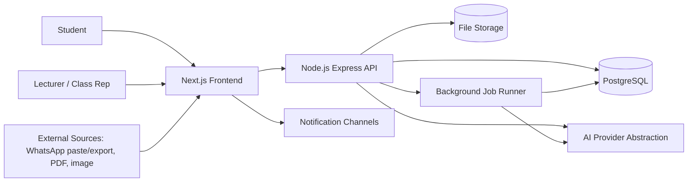
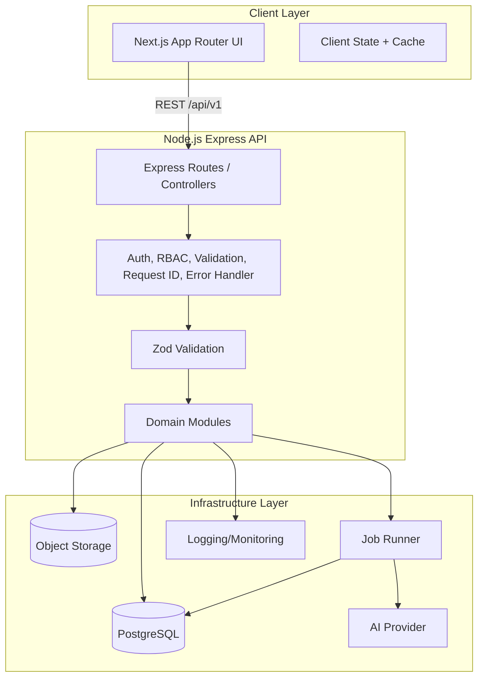
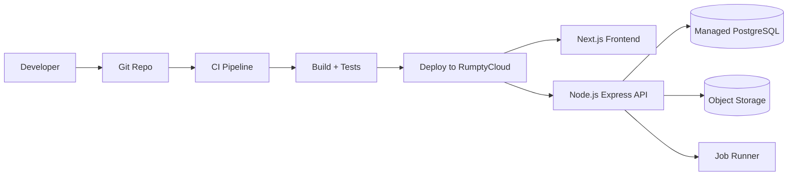
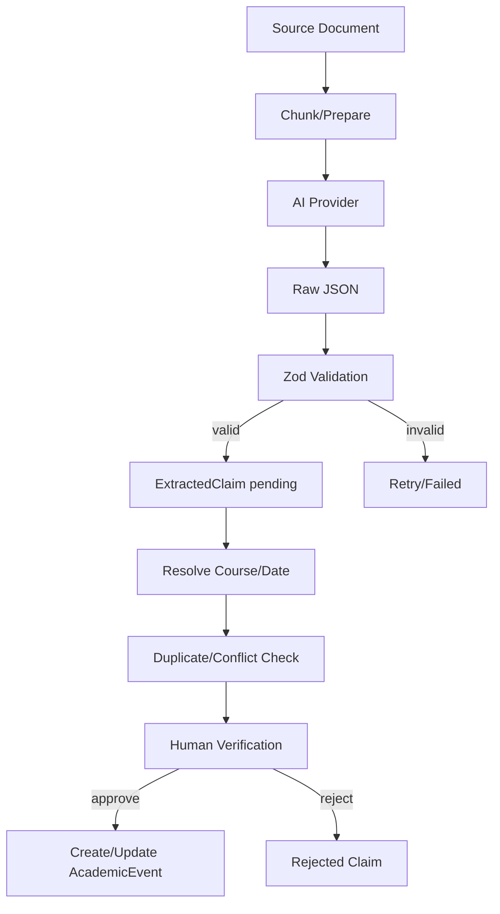
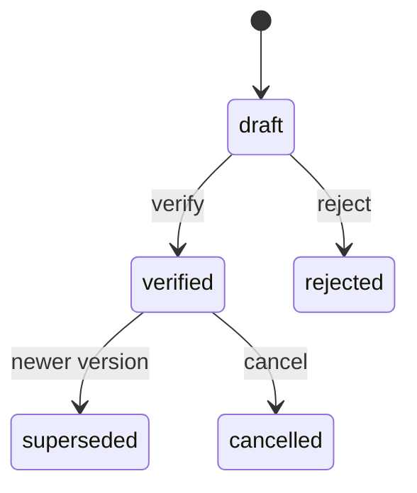
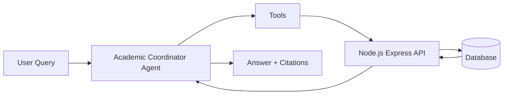

# System Design — Okoa Sem

Status: Proposed (draft for team review)
Related: [Architecture Decisions](./ARCHITECTURE_DECISIONS.md), [Data Model](./DATA_MODEL.md), [API Design](./API_DESIGN.md), [AI Architecture](./AI_ARCHITECTURE.md), [Agent Design](./AGENT_DESIGN.md)

## 1. Architectural goals

- Deliver one reliable end-to-end academic coordination workflow for the hackathon MVP.
- Keep a single authoritative store for academic records; AI proposes, backend validates.
- Preserve source provenance, confidence, verification status and change history for every claim.
- Support multi-tenant isolation by institution (and class group) from day one.
- Keep a modular monolith backend with a separately deployable Node.js API; avoid premature microservices.
- Make ingestion, extraction and verification asynchronous and observable.
- Optimise for team parallelism: clear module boundaries and typed contracts.
- Keep infrastructure simple and reversible.

## 2. System context



Actors:

- Student: consumes academic workspace, verifies claims, tracks submissions.
- Lecturer / Class representative: publishes announcements and academic events.
- System: extraction, duplicate/conflict detection, reminders, notifications.

## 3. High-level architecture

Modular monolith backend (Node.js + JavaScript + Express) with a separate Next.js frontend and async background processing.



Frontend and backend are separate deployable units. Next.js does not host academic domain logic.

Backend modules: `auth`, `users`, `institutions`, `academic`, `ingestion`, `extraction`, `claims`, `events`, `assignments`, `submissions`, `materials`, `reminders`, `notifications`, `assistant`, `audit`.

## 4. Component responsibilities

- Frontend (Next.js): rendering, navigation, forms, client validation, API calls, accessibility.
- Backend (Node.js/Express): authoritative domain logic, validation, permissions, persistence, audit, AI orchestration.
- AI engine: extraction, classification, duplicate/conflict suggestions, assistant retrieval; never writes records directly.
- Background runner: async ingestion processing, extraction, reminders, notifications.
- Database: authoritative academic records and audit trail.

## 5. Frontend architecture

- Next.js App Router with TypeScript.
- Route groups: `(auth)`, `(student)`, `(staff)`, `(admin)`.
- Server components for data fetching where possible; client components for interactive widgets.
- Shared design system in `src/components/ui`.
- API client in `src/lib/api` with typed contracts from `src/contracts`.
- State: React Query/SWR for server state; local state via React hooks.
- Forms: React Hook Form + Zod (client-side validation mirrors backend schemas).
- Calendar: component library behind an adapter.

## 6. Backend architecture

Proposed structure:

```
backend/src/
  config/
  middleware/
  modules/
    auth/
    users/
    institutions/
    academic/
    ingestion/
    extraction/
    claims/
    events/
    assignments/
    submissions/
    materials/
    reminders/
    notifications/
    assistant/
    audit/
  shared/
  app.ts
  server.ts
```

Each module should contain:

- `*.controller.ts` — HTTP request/response handling only.
- `*.service.ts` — business logic.
- `*.repository.ts` — persistence.
- `*.schema.ts` — Zod request/response validation.
- `*.routes.ts` — route registration.

Rules:

- Controllers must not contain business logic.
- Services must not depend on Express request/response objects.
- Repositories are the only module code that accesses the database.
- AI providers must not write to the database; they return structured proposals consumed by services.
- Middleware handles authentication, authorization, request IDs, validation and centralized errors.

## 7. Database architecture

- PostgreSQL as system of record.
- Multi-tenancy via `institution_id` on tenant-scoped tables; app-level filters plus optional RLS.
- UUID primary keys.
- Soft delete where audit value; hard delete only for PII on request per privacy policy.
- Migrations managed by Drizzle ORM (proposed; requires team approval).
- Indexes for tenant + course + date queries.

## 8. AI integration

See [AI Architecture](./AI_ARCHITECTURE.md). Summary:

- Provider abstraction with `extract`, `classify`, `answer` methods.
- Structured outputs validated with Zod.
- Prompts versioned in repository (`prompts/`).
- Every AI result stored as `ExtractedClaim` with source, confidence, status.
- Backend services must validate before creating `AcademicEvent`.

## 9. Background processing

- Node.js backend enqueues asynchronous work for document ingestion, OCR/text extraction, AI extraction, duplicate/conflict detection, reminder scheduling and notification delivery.
- Candidate runners: Inngest or BullMQ (decision remains open).
- Workers must reuse backend domain services and repository interfaces.
- Workers must not bypass validation, permissions or audit requirements.
- Jobs are idempotent and retryable.

## 10. File storage

- Object storage for uploaded documents/images.
- Candidate: S3-compatible or Supabase Storage (proposed).
- Files referenced by `SourceDocument` records; never store binary in DB.
- Virus scanning optional/future; size and type limits enforced.

## 11. Notification processing

- In-app notifications first (MVP).
- Email/SMS/push future.
- Notification records created from domain events.
- Deduplication by event + recipient + channel.

## 12. Authentication

- Email/password + magic link (candidate: Supabase Auth or equivalent).
- Session tokens in httpOnly cookies or bearer tokens for non-browser clients.
- Auth middleware resolves user and tenant context per request.
- MFA optional future.
- OAuth for email ingestion (Gmail) future, not MVP.

## 13. Authorisation

Roles: `student`, `class_rep`, `lecturer`.
- RBAC enforced server-side in middleware/services.
- Tenant isolation: users only access data within their institution and enrolments.
- Verification permissions: only authorised roles can confirm/correct events.

## 14. External integrations

- MVP: manual text paste, file upload (PDF/image), WhatsApp chat export file.
- Future: email OAuth, university portal, LMS, WhatsApp Business API.
- All external data enters as `CommunicationSource` + `SourceDocument`.

## 15. Deployment architecture



- Environments: local, preview, production.
- RumptyCloud as hackathon target (proposed). Confirm capabilities; if unsuitable, use Vercel for frontend + managed Node host/Postgres.
- Frontend and backend may be deployed independently.

## 16. Error handling

- Consistent error envelope (see API design).
- Validation errors return 422 with field details.
- Domain errors mapped to HTTP status.
- AI failures do not corrupt records; claim marked `failed` with reason.
- Client shows retry + support info.

## 17. Observability

- Structured logs (JSON) with request id.
- Error tracking (Sentry or equivalent) proposed.
- Job run metrics and extraction success rates.
- Audit log for sensitive actions.

## 18. Scalability considerations

- Backend monolith scales vertically/horizontally behind load balancer.
- DB connection pooling.
- Queue workers scale independently.
- Cache hot reads only when needed.
- AI calls rate-limited and batched.

## 19. Non-goals (MVP)

- No microservices.
- No real-time chat.
- No grading engine.
- No full LMS.
- No autonomous deadline changes.
- No Next.js Route Handlers as primary domain backend.

## 20. Information ingestion flow

```mermaid
flowchart LR
  User[User] --> Input[Paste/Upload/Export]
  Input --> FE[Next.js Frontend]
  FE --> API[Node.js Express API]
  API --> Source[CommunicationSource + SourceDocument]
  Source --> ExtractText[Text/OCR Extraction]
  ExtractText --> Job[Background Job]
  Job --> AI[AI Extraction]
  AI --> Claims[ExtractedClaim (pending)]
  Claims --> Review[Human Review]
  Review --> Event[AcademicEvent (verified)]
```

## 21. AI extraction and verification flow



## 22. Academic event lifecycle



## 23. Agent and workflow interaction


