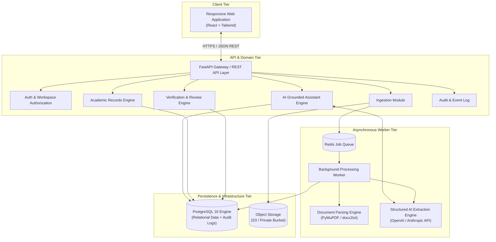
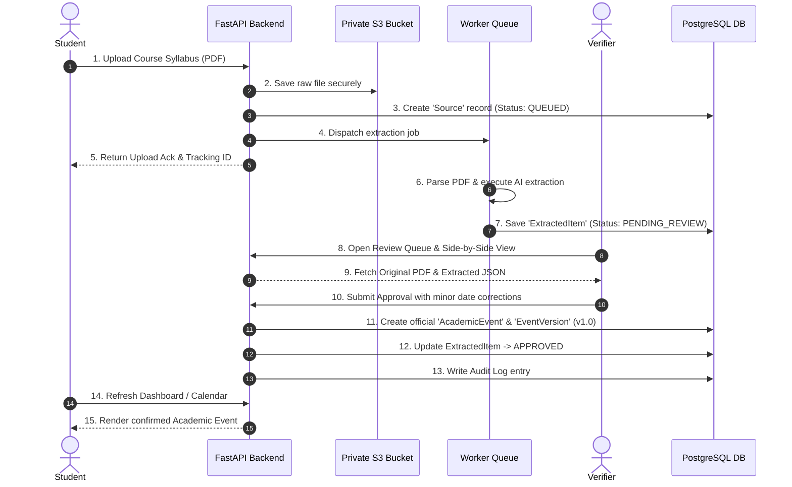

# Academic Coordination Intelligence Platform
## Comprehensive System Design & Architecture Specification

**Document Version:** 1.1  
**Status:** Architecture Specification Baseline  
**Date:** 7 November 2026  
**Target Platform:** Web Application (Responsive)  
**Primary Users:** Students, Academic Verifiers, Workspace Administrators  

---

## 1. Executive Summary & Design Philosophy

The **Academic Coordination Intelligence Platform** addresses academic information fragmentation across documents, emails, announcements, and informal messaging platforms. The primary objective is to convert unstructured, dispersed communications into a unified, traceable, and actionable academic timeline for students.

### 1.1 Core Architectural Principles

1. **Database as the Sole Source of Truth:** AI model inferences are strictly treatable as *extraction proposals*. Unverified or auto-generated content never mutates official shared academic records.
2. **Mandatory Human-in-the-Loop (HITL) Gatekeeping:** Extracted shared information remains in a `PENDING_REVIEW` state until explicitly authorized by a designated Verifier.
3. **Immutability and Full Auditing:** Academic updates create versioned snapshots (`EventVersion`) rather than performing destructively inline overwrites. Every official record is bi-directionally linked to its originating source asset.
4. **Backend-Enforced Least Privilege Security:** Access control and tenant boundary policies (at the workspace level) are enforced exclusively by the backend API and database policies.
5. **Fail-Safe Asynchronous Processing:** File parsing, text extraction, AI schema matching, and notifications operate outside the synchronous request-response lifecycle to ensure high availability and responsiveness.

---

## 2. High-Level Architecture & Component Interaction

The platform follows a **Modular Monolith Architecture** with asynchronous background processing workers. This guarantees domain isolation without introducing microservices operational complexity during early deployment stages.



---

## 3. Modular Backend Architecture

| Module Name | Domain Scope & Core Responsibilities |
|---|---|
| `auth` | User identity lifecycle, JWT token issuing, password hashing (Argon2id), and RBAC context enforcement. |
| `workspaces` | Context management for academic programs, courses, terms, and multi-tenant isolation. |
| `ingestion` | File upload handling, manual announcement ingestion, email webhook intake, file format validation. |
| `parsing` | Asynchronous extraction of clean markdown/text content from PDF, DOCX, and raw email payloads. |
| `ai` | Schema-driven extraction using Pydantic validation; vector/keyword retrieval for grounded assistant Q&A. |
| `reviews` | Managing human verifier queues, status transitions (`PENDING`, `APPROVED`, `REJECTED`, `CLARIFICATION_NEEDED`). |
| `academic_records` | Core source-of-truth management for confirmed events, deadlines, timetable revisions, and version snapshots. |
| `coordination` | Student-facing dashboard aggregation, personal task tracking, calendar feed generation, and duplicate/conflict detection. |
| `notifications` | Dispatch of in-app state changes, deadline alerts, and review updates. |
| `audit` | Append-only security log tracking all domain state modifications, approvals, user role changes, and data queries. |

---

## 4. End-to-End User Workflows



---

## 5. Normalized Relational Data Schema

```sql
-- Core Domain Database Blueprint (PostgreSQL 16)

CREATE TYPE user_role AS ENUM ('STUDENT', 'VERIFIER', 'ADMINISTRATOR');
CREATE TYPE review_status AS ENUM ('PENDING', 'APPROVED', 'REJECTED', 'NEEDS_CLARIFICATION');
CREATE TYPE event_status AS ENUM ('DRAFT', 'CONFIRMED', 'CANCELLED', 'SUPERSEDED');

-- Users & Authentication
CREATE TABLE users (
    id UUID PRIMARY KEY DEFAULT gen_random_uuid(),
    email VARCHAR(255) UNIQUE NOT NULL,
    password_hash VARCHAR(255) NOT NULL,
    full_name VARCHAR(255) NOT NULL,
    created_at TIMESTAMP WITH TIME ZONE DEFAULT CURRENT_TIMESTAMP
);

-- Workspaces (Tenant Container)
CREATE TABLE workspaces (
    id UUID PRIMARY KEY DEFAULT gen_random_uuid(),
    name VARCHAR(255) NOT NULL,
    institution_name VARCHAR(255) NOT NULL,
    academic_year VARCHAR(50) NOT NULL,
    created_at TIMESTAMP WITH TIME ZONE DEFAULT CURRENT_TIMESTAMP
);

-- Workspace Membership & Authorization
CREATE TABLE workspace_memberships (
    id UUID PRIMARY KEY DEFAULT gen_random_uuid(),
    user_id UUID NOT NULL REFERENCES users(id) ON DELETE CASCADE,
    workspace_id UUID NOT NULL REFERENCES workspaces(id) ON DELETE CASCADE,
    role user_role NOT NULL DEFAULT 'STUDENT',
    UNIQUE (user_id, workspace_id)
);

-- Courses within a Workspace
CREATE TABLE courses (
    id UUID PRIMARY KEY DEFAULT gen_random_uuid(),
    workspace_id UUID NOT NULL REFERENCES workspaces(id) ON DELETE CASCADE,
    code VARCHAR(50) NOT NULL,
    title VARCHAR(255) NOT NULL,
    instructor_name VARCHAR(255),
    UNIQUE (workspace_id, code)
);

-- Uploaded Sources (The immutable evidence)
CREATE TABLE sources (
    id UUID PRIMARY KEY DEFAULT gen_random_uuid(),
    workspace_id UUID NOT NULL REFERENCES workspaces(id) ON DELETE CASCADE,
    submitted_by UUID NOT NULL REFERENCES users(id),
    source_type VARCHAR(50) NOT NULL, -- 'FILE_UPLOAD', 'MANUAL_ENTRY', 'EMAIL_IMPORT'
    file_storage_key VARCHAR(512),
    raw_payload TEXT,
    received_at TIMESTAMP WITH TIME ZONE DEFAULT CURRENT_TIMESTAMP
);

-- Extracted AI Proposals
CREATE TABLE extracted_items (
    id UUID PRIMARY KEY DEFAULT gen_random_uuid(),
    source_id UUID NOT NULL REFERENCES sources(id) ON DELETE CASCADE,
    course_id UUID REFERENCES courses(id),
    proposed_payload JSONB NOT NULL,
    status review_status DEFAULT 'PENDING',
    created_at TIMESTAMP WITH TIME ZONE DEFAULT CURRENT_TIMESTAMP
);

-- Human Verification Decisions
CREATE TABLE review_decisions (
    id UUID PRIMARY KEY DEFAULT gen_random_uuid(),
    extracted_item_id UUID NOT NULL REFERENCES extracted_items(id) ON DELETE CASCADE,
    verifier_id UUID NOT NULL REFERENCES users(id),
    decision review_status NOT NULL,
    comments TEXT,
    reviewed_at TIMESTAMP WITH TIME ZONE DEFAULT CURRENT_TIMESTAMP
);

-- Confirmed Shared Academic Events (Published Facts)
CREATE TABLE academic_events (
    id UUID PRIMARY KEY DEFAULT gen_random_uuid(),
    workspace_id UUID NOT NULL REFERENCES workspaces(id) ON DELETE CASCADE,
    course_id UUID NOT NULL REFERENCES courses(id),
    title VARCHAR(255) NOT NULL,
    description TEXT,
    event_type VARCHAR(50) NOT NULL, -- 'ASSIGNMENT', 'CAT', 'FINAL_EXAM', 'ANNOUNCEMENT'
    current_version INT DEFAULT 1,
    status event_status DEFAULT 'CONFIRMED',
    start_at TIMESTAMP WITH TIME ZONE,
    due_at TIMESTAMP WITH TIME ZONE NOT NULL,
    created_at TIMESTAMP WITH TIME ZONE DEFAULT CURRENT_TIMESTAMP
);

-- Event History Snapshots
CREATE TABLE event_versions (
    id UUID PRIMARY KEY DEFAULT gen_random_uuid(),
    event_id UUID NOT NULL REFERENCES academic_events(id) ON DELETE CASCADE,
    version_number INT NOT NULL,
    snapshot_payload JSONB NOT NULL,
    source_id UUID NOT NULL REFERENCES sources(id),
    approved_by UUID NOT NULL REFERENCES users(id),
    created_at TIMESTAMP WITH TIME ZONE DEFAULT CURRENT_TIMESTAMP,
    UNIQUE (event_id, version_number)
);

-- Student Personal Tasks
CREATE TABLE tasks (
    id UUID PRIMARY KEY DEFAULT gen_random_uuid(),
    user_id UUID NOT NULL REFERENCES users(id) ON DELETE CASCADE,
    event_id UUID REFERENCES academic_events(id) ON DELETE SET NULL,
    title VARCHAR(255) NOT NULL,
    is_completed BOOLEAN DEFAULT FALSE,
    due_at TIMESTAMP WITH TIME ZONE,
    created_at TIMESTAMP WITH TIME ZONE DEFAULT CURRENT_TIMESTAMP
);

-- System Audit Log
CREATE TABLE audit_logs (
    id UUID PRIMARY KEY DEFAULT gen_random_uuid(),
    actor_id UUID REFERENCES users(id),
    action VARCHAR(100) NOT NULL,
    entity_type VARCHAR(50) NOT NULL,
    entity_id UUID NOT NULL,
    metadata JSONB,
    created_at TIMESTAMP WITH TIME ZONE DEFAULT CURRENT_TIMESTAMP
);
```

---

## 6. AI Ingestion, Guardrails, and Structured Extraction

To avoid generative hallucinations and maintain strict backend data typing, all AI extractions use constrained schema outputs (via OpenAI Structured Outputs or Pydantic Validation via Instructor).

### 6.1 Target Extraction Pydantic Schema

```python
from pydantic import BaseModel, Field
from typing import Optional, List
from datetime import datetime

class ExtractedAcademicEvent(BaseModel):
    course_code: Optional[str] = Field(description="Extracted course code e.g. CS101")
    event_type: str = Field(description="One of: ASSIGNMENT, CAT, EXAM, ANNOUNCEMENT, LECTURE_CANCELLED")
    title: str = Field(description="Clear title summarizing the requirement")
    due_date: Optional[datetime] = Field(description="ISO format deadline or event time")
    location_or_venue: Optional[str] = Field(description="Physical venue or online URL if specified")
    instructions: Optional[str] = Field(description="Submission guidelines or instructions")
    confidence_score: float = Field(description="Confidence rating between 0.0 and 1.0")
    clarification_flags: List[str] = Field(default=[], description="List of ambiguous fields requiring human review")
```

### 6.2 Grounded RAG Assistant Guardrails

1. **Strict Context Filtering:** The AI Assistant retrieves records filtered explicitly by `workspace_id` and `user_id` permissions.
2. **Citation Requirement:** Every answer generated by the AI assistant MUST reference the specific `academic_event_id` and linked `source_id`.
3. **Fallback Policy:** If no confirmed record satisfies the prompt, the assistant must return:  
   *"I could not find an official, confirmed record for this item. Please check the pending verification queue or contact your course verifier."*

---

## 7. Security Architecture & Boundary Controls

1. **Authentication:** Bearer tokens (JWT) with asymmetric cryptographic signatures (RS256) containing `user_id` and current `workspace_id`.
2. **Tenant Data Isolation:** Every query against operational tables (`courses`, `sources`, `academic_events`) must implicitly attach `WHERE workspace_id = :current_workspace_id`.
3. **Object Storage Integrity:** Raw document objects in S3 are non-public (`private`). Access is served via short-lived pre-signed URLs (expiration ≤ 15 minutes) restricted to authorized workspace verifiers.
4. **Data Minimization:** AI service endpoints receive only cleaned plain text. Personally Identifiable Information (PII) like phone numbers or grading